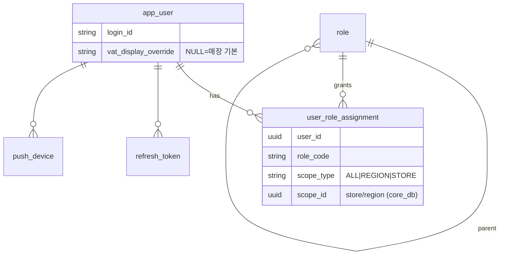
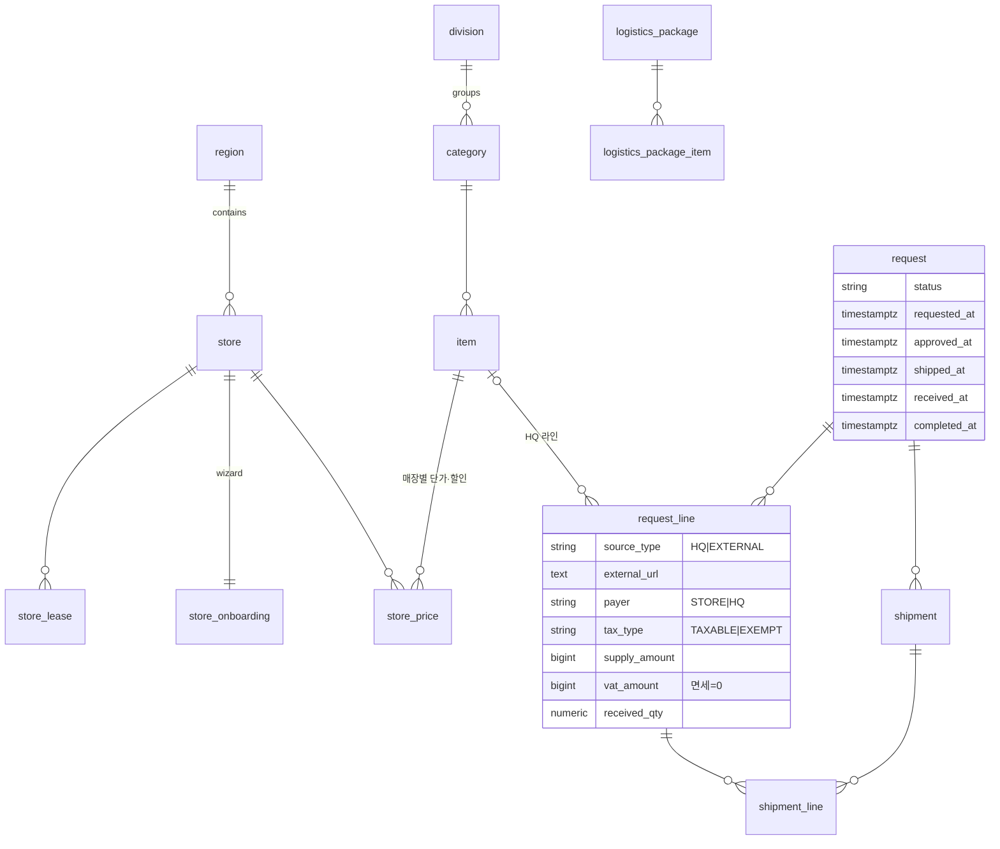
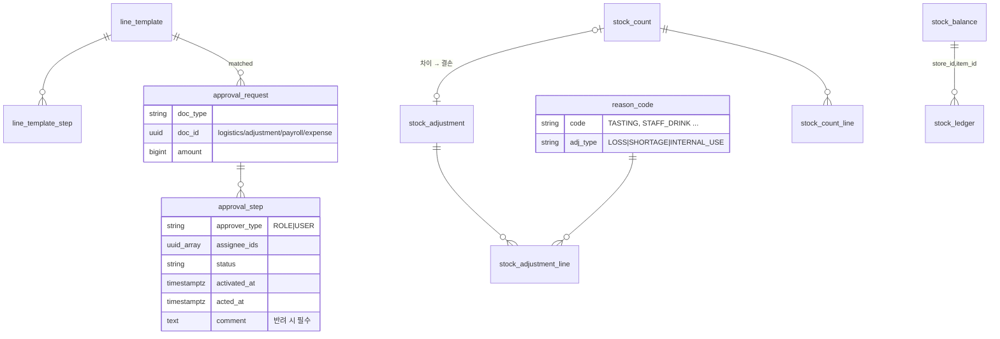
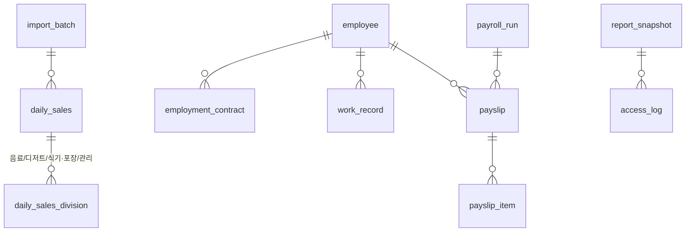
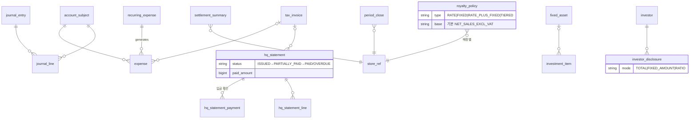

# Espresso ERD

DDL 원본: `db/auth`, `db/core`, `db/settlement` (PostgreSQL 16, Flyway 형식, 로컬 PostgreSQL 16에서 적용 검증 완료).
DB 간에는 FK 없이 ID 값으로만 참조합니다(점선 = DB 경계 너머 값 참조).

## 1. DB 구성

| DB (클러스터) | 스키마 | 소유 서비스 |
|---|---|---|
| `auth_db` | `auth` | auth-service |
| `core_db` | `common`, `store`, `catalog`, `approval`, `logistics`, `inventory`, `sales`, `hr`, `report`, `notify` | 각 서비스 (스키마 = 서비스 경계) |
| `settlement_db` | `stl` | settlement-service |

## 2. auth

## 3. core — 매장·카탈로그·물류

## 4. core — 결재·재고

공통: `common.attachment`, `common.doc_comment`(메모), `common.status_history`(모든 상태 전이 시각) 은 `(doc_type, doc_id)` 로 모든 문서에 연결.

## 5. core — 매출·인사·리포트

## 6. settlement

## 7. 이벤트 → 분개 매핑

| 이벤트 | 차변 | 대변 |
|---|---|---|
| DailySalesClosed | 현금/외상매출금(카드) | 상품매출-구분별(401 음료·402 디저트·406 식기·포장·403 기타), 부가세예수금 |
| LogisticsReceived (매장 결제) | 상품(재고) 또는 비품, 부가세대급금 | 외상매입금/보통예금 |
| — 비품 판단 | 설비 카테고리, 또는 카테고리 비품 기준 단가 이상(고가 식기) → 비품(206) + fixed_asset(구분 기록) | |
| LogisticsReceived (본사 결제) | 상품(재고) 또는 비품, 부가세대급금 | **미지급금(본사)** |
| StockAdjustmentApproved — 손실 | 재고자산폐기손실 | 상품 |
| — 결손(실사·배송) | 재고자산감모손실 | 상품 |
| — 결손(시음·샘플·직원음료) | 시음·샘플·직원음료 | 상품 |
| — 내부사용 | 소모품비 | 상품 |
| — 손실(식기 파손) | 재고자산폐기손실 (구분: 식기·포장) | 상품 |
| StockConsumed (실사 판매 소진) | 음료·디저트: 매출원가 / 식기·포장·관리: 소모품비 | 상품 |
| 비품 폐기 (결산 › 설비·비품) | 감가상각누계액, 유형자산처분손실(970) | 비품(206) |
| PayrollConfirmed | 급여·잡급·제수당, 복리후생비, 퇴직급여 | 예수금, 미지급금, 퇴직급여충당부채 |
| ExpenseApproved | 지급임차료/수도광열비/… , 부가세대급금 | 미지급금 또는 미지급금(본사) |
| 월 마감 로열티 | 지급로열티 | 미지급금(본사) |
| 정산서 입금 확인 | 미지급금(본사) | 보통예금 |
